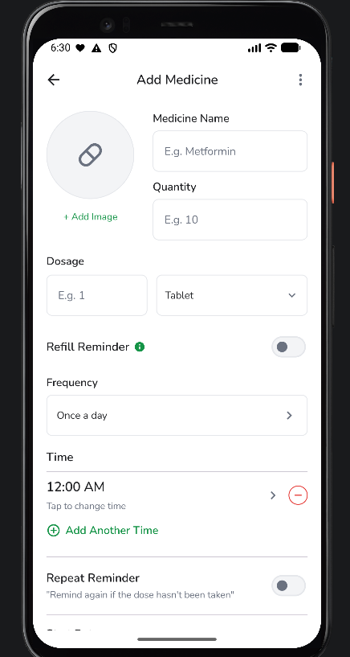
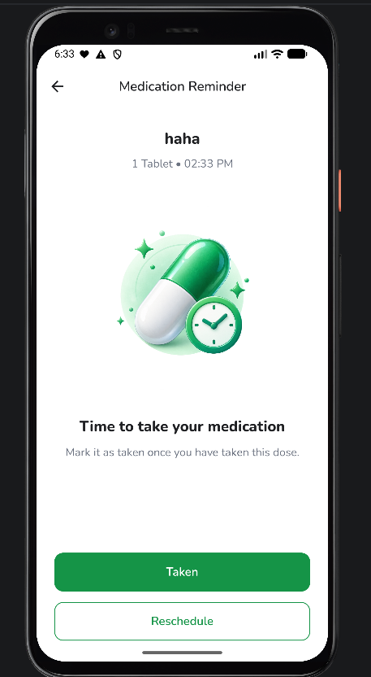
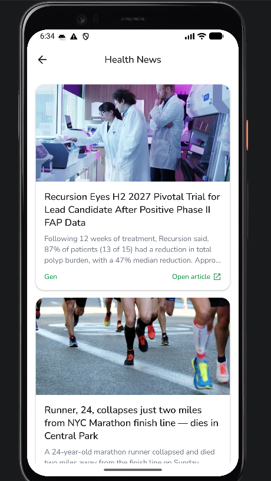
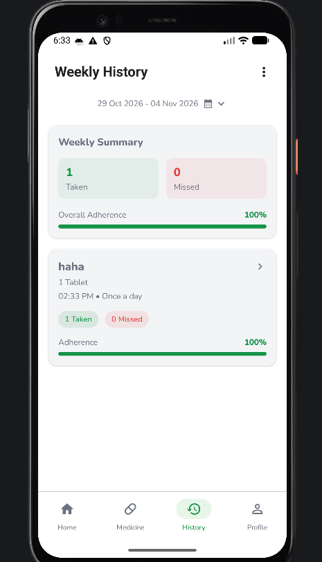
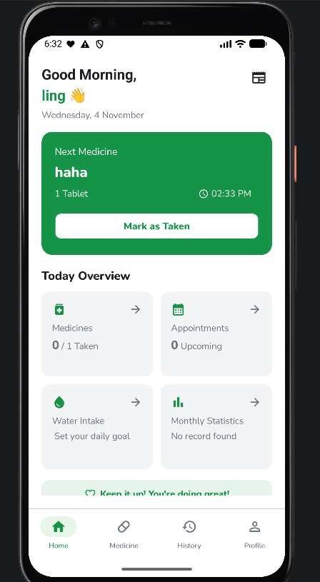

# Smart Medication Companion

## 1. Project Overview

Smart Medication Companion is an Android application developed to help users manage their medication routines and access medication-related information.
The application provides features such as medicine reminders, medication-related news, and weekly medication history.
It aims to make medication management more organised and convenient through a mobile application.

## 2. Project Objectives

The main objectives of this project are:
- To provide users with a convenient way to manage their medication routines.
- To help users keep track of their medication schedules through reminders.
- To provide access to medication-related news and information.
- To allow users to review their medication history on a weekly basis.

## 3. Key Features

### 3.1 Medication Management

Allows users to manage their medication information through CRUD (Create, Read, Update, Delete) operations. 
Users can add new medicines, view existing medication records, update medicine details, and delete medicines when they are no longer needed.

### 3.2 Medicine Reminder

This feature helps users manage their medication schedules by providing a reminder function. 
It is designed to help users keep track of their medication routines and reduce the chance of forgetting scheduled medication.

### 3.3 Medication News

The news page provides medication-related news and information within the application. 
It allows users to access relevant content without leaving the app.

### 3.4 Weekly Medication History

This feature allows users to review their medication history on a weekly basis. 
It provides a way to look back at their medication records and monitor their medication-taking activity.

## 4. Technologies Used

| Technology       | Purpose                                           |
| Kotlin           | Main programming language for Android development |
| Android Studio   | Development environment                           |
| Jetpack Compose  | Building the Android user interface               |
| Supabase         | Backend and database integration                  |

## 5. My Contributions

As a member of the development team, I was responsible for developing the following features:

- Medication Management: Implemented CRUD operations using Supabase, allowing users to create, view, update, and delete medication records.
- Medicine Reminder: Developed the medicine reminder functionality and integrated it with Supabase to manage medication-related data.
- Medication News: Developed the news page for displaying medication-related information.
- Weekly Medication History: Implemented the weekly history page to allow users to review their medication records.

Through these contributions, I gained practical experience in Android application development, database integration, and implementing application features using Kotlin and Jetpack Compose.

## 6. Project Structure

The project follows an Android application structure, with the main application code and resources organised within the project directories.

- app/ – Contains the main Android application module.
- gradle/ – Contains Gradle-related configuration files.
- build.gradle.kts – Contains project-level build configuration.
- settings.gradle.kts – Defines the project configuration and included modules.

## 7. Project Information

- Project Name: Smart Medication Companion
- Platform: Android
- Project Type: Academic Group Project
- Development Language: Kotlin

## 8. Author's Contribution

This project was completed collaboratively as part of an academic group assignment. 
The contributions listed above represent my individual responsibilities within the project.

## 9. Application Screenshots

### Medication Management

.png)

### Medicine Reminder

.png)
.png)

### Medication News

### Weekly Medication History

.png)

### Home Page

